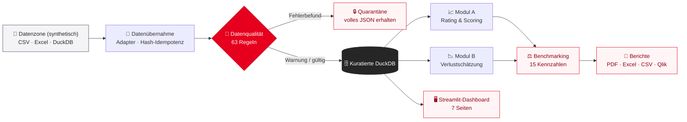

<div align="center">

# 🏦 Risikoportfolio-Berichtswesen

**Automatisierte Berichtspipeline für eine fiktive Sparkassen-Berichtsgemeinschaft**

Synthetische Quelldaten in mehreren Formaten · eine gesteuerte Datenübernahme- und
Datenqualitätsschicht · ein kuratiertes DuckDB-Warehouse · zwei unabhängige Risikomodule ·
institutsübergreifendes Benchmarking · automatisierte Berichterstellung mit vollständigem
Prüfpfad · und ein Live-Dashboard.


</div>

> ⚠️ **DISCLAIMER — SYNTHETISCHE DEMONSTRATIONSDATEN.** Alle Institute (SSK001–SSK005,
> „Muster-Sparkasse …“), Kunden, Positionen, Ratings, Sicherheiten und Zahlungsströme sind
> erfunden. Dies ist **keine regulatorische Berichterstattung** und enthält keine echten
> Sparkassen-, Kunden- oder Portfoliodaten. Die Berichtsverteilung ist simuliert; es existiert
> **kein Qlik-Server** — nur Qlik-fähige Dateiexporte.

---

## 🧭 Umfang

| Bereich | Inhalt |
|---|---|
| **Modul A — Rating & Scoring** | EAD-gewichtete PD, Ratingverteilungen, beobachtete Ausfallquoten 12M, Ratingmigration |
| **Modul B — Verlustschätzung** | Besicherungsquote nach Haircuts, besichertes/unbesichertes EAD, 12M-Ausfallkohorte, Verwertungs- und Verlustquoten, Verwertungszahlungen |
| **Gemeinsame Infrastruktur** | Quellkatalog und Adapter (CSV/Excel/DuckDB in drei Dialekten) · 63 Datenqualitätsregeln mit Quarantäne · kuratiertes DuckDB-Warehouse · Vergleichsgruppen-Benchmarking (15 Kennzahlen) · Berichtsgenerierung (PDF, Excel, CSV, Qlik-Sternschema) · simulierte Verteilung · Prüfprotokolle · 7-seitiges Streamlit-Dashboard |

## 🏛️ Architektur



## 📐 Gestaltungsprinzipien

1. **Vollständig offline** — Python, DuckDB und lokale Dateien; keine externen oder
   kostenpflichtigen Dienste, keine vorgetäuschten Integrationen.
2. **Gemeinsame Infrastruktur zuerst** — beide Risikomodule docken einheitlich an dieselbe
   Daten- und Berichtsebene an.
3. **Deterministisch** — synthetische Daten mit festem Seed; 163 Tests mit von Hand
   berechneten Erwartungswerten.
4. **Fehler werden isoliert, nie stillschweigend behoben** — Fehlerdatensätze gehen in die
   Quarantäne (mit vollem JSON), Warnungen werden geladen und markiert; kuratierte Daten
   werden nie überschrieben (idempotente Übernahme).

## ⚙️ Voraussetzungen

- Python 3.12 (3.10+ sollte funktionieren) · Windows/macOS/Linux
- ca. 200 MB freier Speicherplatz

```powershell
python -m pip install -r requirements.txt
```

## 🚀 Schnellstart

```powershell
# 1. Synthetische Datenzone erzeugen (5 Institute × 4 Datensätze × 9 Quartale)
python -m synthetic_data.generate_data

# 2. Übernehmen, prüfen und in die kuratierte DuckDB laden
python -m etl.pipeline --reset-db

# 3. Alle Berichtsartefakte erzeugen (PDF, Excel, CSV, Qlik)
python -m reporting.cli

# 4. Live-Dashboard starten
streamlit run app.py
```

Dann <http://localhost:8501> öffnen. Die Schritte 1–3 können gefahrlos wiederholt werden:
`--reset-db` baut das Warehouse neu auf; ohne den Schalter werden identische Dateien
übersprungen (Hash-Idempotenz).

## 📦 Artefakte und Pfade

| Artefakt | Pfad |
|---|---|
| Synthetische Datenzone | `data/synthetic/landing/` |
| Generierungsmanifest | `data/synthetic/master/generation_manifest.json` |
| Kuratierte DuckDB | `data/processed/risk_portfolio.duckdb` |
| Berichtsgemeinschafts-/Instituts-PDFs | `reports/<Datum>/community/`, `reports/<Datum>/institutions/` |
| Generierungszusammenfassung | `reports/<Datum>/generation_summary.json` |
| Excel-Arbeitsmappen (14 Blätter) | `data/exports/<Datum>/excel/` |
| CSV-Paket (ZIP) | `data/exports/<Datum>/csv/` |
| Qlik-Sternschema + Ladeskript | `data/exports/qlik/<Datum>/` |
| Pipeline-Protokolle | `logs/` |

`<Datum>` ist der Berichtsstichtag, z. B. `2026-09-30`.

## 🖥️ Dashboard (Streamlit — die Live-Ansicht)

`app.py` steuert sieben Seiten über eine obere Navigationsleiste (ohne Seitenleiste); alle
Seiten lesen dieselbe kuratierte DuckDB über zwischengespeicherten Zugriff
(`dashboard/common.py`). Die Oberfläche ist deutsch, einschließlich deutscher Zahlen- und
Datumsformate (Dezimalkomma, Tausenderpunkt, `TT.MM.JJJJ`). Die Umfangsfilter
(Berichtsstichtag, Institute, Wirtschaftssektoren) liegen als kompakte Pill-Auswahl direkt im
Hauptbereich:

| Seite | Inhalt |
|---|---|
| **Überblick** | Kennzahlen der Berichtsgemeinschaft und Stichtagsnavigation |
| **Rating & Scoring** | Modul-A-Ansichten (PD, Verteilung, Ausfälle, Migration) |
| **Verlustschätzung** | Modul-B-Ansichten (Sicherheiten, Verwertung, Verlust, Zahlungsströme) |
| **Benchmarking** | Vergleichsgruppenvergleich inkl. interaktiver What-if-Übersteuerungen |
| **Datenqualität** | Scores, Befunde, Quarantäne-Browser |
| **Datenübernahme** | Batch-Historie und Ladeergebnisse |
| **Reporting** | Artefakt-Register und Neuerzeugung aus der Oberfläche |

Streamlit ist das lokale Live-Dashboard des Prototyps, **nicht** das Enterprise-BI-Werkzeug.
Qlik Sense ist das Exportziel (siehe unten).

## 🧾 CLI-Referenz

```powershell
python -m synthetic_data.generate_data                       # Quelldaten neu erzeugen
python -m etl.pipeline [--reset-db] [--bank SSK001] [--dataset exposures]
python -m reporting.cli [--reporting-date 2026-09-30] [--bank SSK001] [--sector RETAIL]
                         [--formats pdf excel csv qlik]
                         [--no-community|--no-institutions|--no-distribution]
streamlit run app.py                                        # Dashboard
python -m pytest tests/ -q                                  # 163 Tests
```

## 🧪 Datenqualität

63 Regeln in vier Kategorien (Vollständigkeit, Konsistenz, Plausibilität, Eindeutigkeit)
über vier Datensätze hinweg; 54 ERROR / 9 WARNING. Fehlerbefunde stellen den Datensatz in
die Quarantäne (volles JSON-Payload bleibt erhalten); Warnbefunde werden markiert und
geladen. Batch-Ergebnisse: `ACCEPTED` / `ACCEPTED_WITH_WARNINGS` / `QUARANTINED`.
Vollständiger Regelkatalog: `docs/data_quality_rules.md`.

## 📈 Kennzahlen und Benchmarking

Alle KPIs und die 15 Benchmark-Kennzahlen mit Formeln, Wirkungsrichtung und
Aggregationssemantik (Zähler/Nenner-Aggregate, niemals Mittelwerte von Quoten; das
Institut wird aus seiner eigenen Vergleichsreferenz ausgeschlossen; Schwellen ±10 % relativer
Abstand für BETTER/WORSE): `docs/metric_definitions.md`.

## 🔄 Qlik-Integration (Exportziel, keine Live-Verbindung)

`python -m reporting.cli --formats qlik` erzeugt 18 CSV-Tabellen im Sternschema
(Dimensionen: Institut, Rating, Sicherheitsart, Datum, Kennzahl) plus ein Beispiel-
`load_script.qvs` in `data/exports/qlik/<Datum>/`. Ein Qlik-Entwickler lädt diese Dateien
lokal. **Es wird kein Qlik-Server, Konnektor oder ausgerollte Anwendung beansprucht** — der
CSV-Übergang ist die ehrliche Grenze eines lokalen Prototyps. Details:
`docs/qlik_integration.md`.

## 🔧 Konfiguration

Alle Annahmen liegen in `config/` — eine Stelle, um alles zu ändern:
`settings.py` (Pfade über Umgebungsvariablen `RISK_DB_PATH`, `RISK_REPORT_DIR`,
`RISK_EXPORT_DIR`, `RISK_SYNTHETIC_DIR`; Ratingskala, Schwellen, Disclaimer),
`institutions.py` / `peer_groups.py` (Institute und Vergleichsgruppen),
`rating_pd_mapping.py` (Ratingstufe → PD 12M), `collateral_haircuts.py`
(Sicherheitenart → Haircut), `source_catalog.py` (Inventar und Formate der Datenzone).

## ✅ Tests

```powershell
python -m pytest tests/ -q          # 163 bestanden in ca. einer Minute
```

<details>
<summary><b>Testdateien im Einzelnen</b></summary>

| Datei | Deckt ab |
|---|---|
| `test_transformations.py` | Zahlen-/Flaggen-Parsing, Zuordnungen, Datensatz-IDs |
| `test_ingestion.py` | Adapter (CSV-Dialekte, Excel, DuckDB), Manager, Idempotenz |
| `test_data_quality.py` | jede Regel, Ladeergebnisse, Quarantäne |
| `test_rating_scoring.py` | Modul-A-Mathematik gegen von Hand berechnete Werte |
| `test_loss_estimation.py` | Modul-B-Mathematik gegen von Hand berechnete Werte |
| `test_benchmarking.py` | Vergleichsgruppen-Aggregation, Flags, Ränge, Übersteuerungen |
| `test_reporting.py` | Kontext, Exporte, End-to-End-Erzeugung gegen eine temporäre Datenbank, Prüfprotokoll, CLI |
| `test_dashboard.py` | Streamlit-`AppTest`-Renderprüfungen für alle Seiten |

</details>

Erwartungswerte werden in den Test-Docstrings von Hand hergeleitet — die Tests implementieren
die Modullogik nie erneut.

## 📚 Dokumentation

| Dokument | Inhalt |
|---|---|
| `docs/architecture.md` | Schichten, Datenfluss, Entwurfsentscheidungen |
| `docs/data_dictionary.md` | Datenzone, kuratiertes Schema, Prüftabellen, Referenzwerte |
| `docs/metric_definitions.md` | Modul-A/B-KPIs und Benchmark-Formeln |
| `docs/data_quality_rules.md` | der 63-Regel-Katalog und Schwergrade-Semantik |
| `docs/qlik_integration.md` | Sternschema, Ladeskript, Integrationsgrenze |
| `docs/deployment.md` | kostenloses Hosting des Dashboards auf Streamlit Community Cloud |
| `docs/interview_demo.md` | geführte 10-Schritte-Demo (5–10 Minuten) |

`docs/interview_demo.md` ist der Drehplan für eine Live-Präsentation — damit lässt sich die
Pipeline vollständig Ende-zu-Ende zeigen.

## ☁️ Deployment

Das Dashboard lässt sich kostenlos auf [Streamlit Community Cloud](https://streamlit.io/cloud)
hosten (das Repository als App, `app.py` als Einstiegspunkt). Schritt-für-Schritt-Anleitung:
`docs/deployment.md`.

---

<div align="center">

**Fiktive Sparkassen-Berichtsgemeinschaft · synthetische Daten · lokal und deterministisch**

*Kein echtes Kreditinstitut · keine echten Kundendaten · keine regulatorische Berichterstattung*

</div>
